# Mini E-commerce | Nuvix

Mini e-commerce em PHP com Slim 4 e Twig 3. O projeto reúne uma loja de roupas e acessórios autorais, com a identidade visual Nuvix, e uma área de gestão de produtos, cupons e pedidos.

## Prints da aplicação

Capturas reais do ambiente local de demonstração, com dados de contato fictícios nas telas de conferência. Os arquivos estão em [docs/images/aplicacao/](docs/images/aplicacao/). Clique em uma imagem para abrir a versão completa.

### Vitrine

[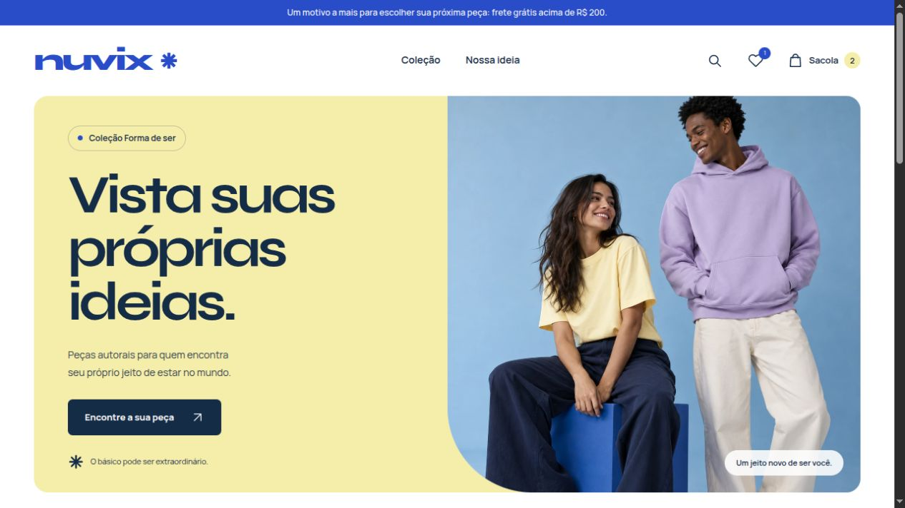](docs/images/aplicacao/01-vitrine.jpg)

<details>
<summary>Ver catálogo, detalhes do produto, sacola e entrega</summary>

### Catálogo

Busca, filtros por categoria, ordenação, favoritos e cores clicáveis nos cartões.

[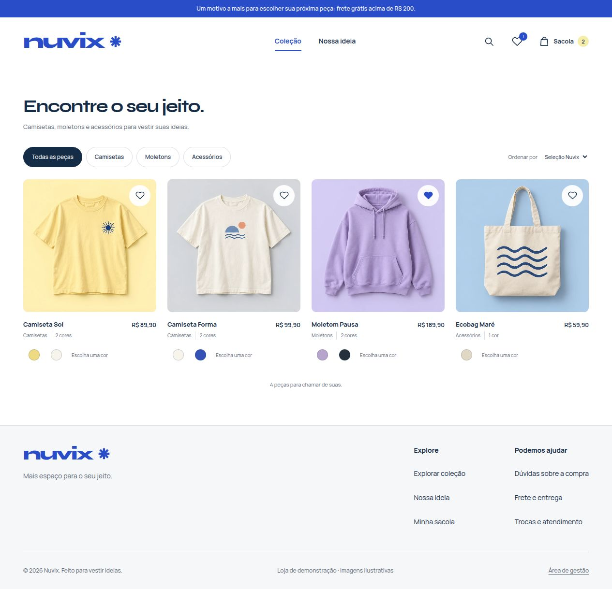](docs/images/aplicacao/02-catalogo.jpg)

### Detalhes do produto

Foto em destaque que acompanha a cor escolhida, galeria com outros ângulos, ampliação, tamanhos e informações sobre a peça.

[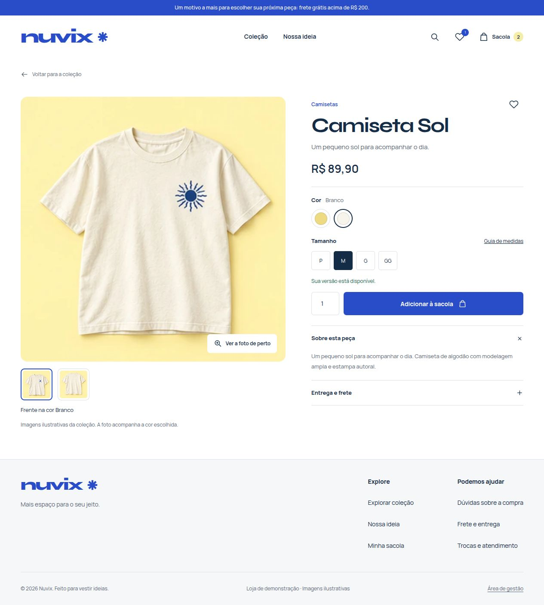](docs/images/aplicacao/03-detalhes-produto.jpg)

### Sacola lateral

Quantidade, remoção de peças, frete e total sem sair do catálogo.

[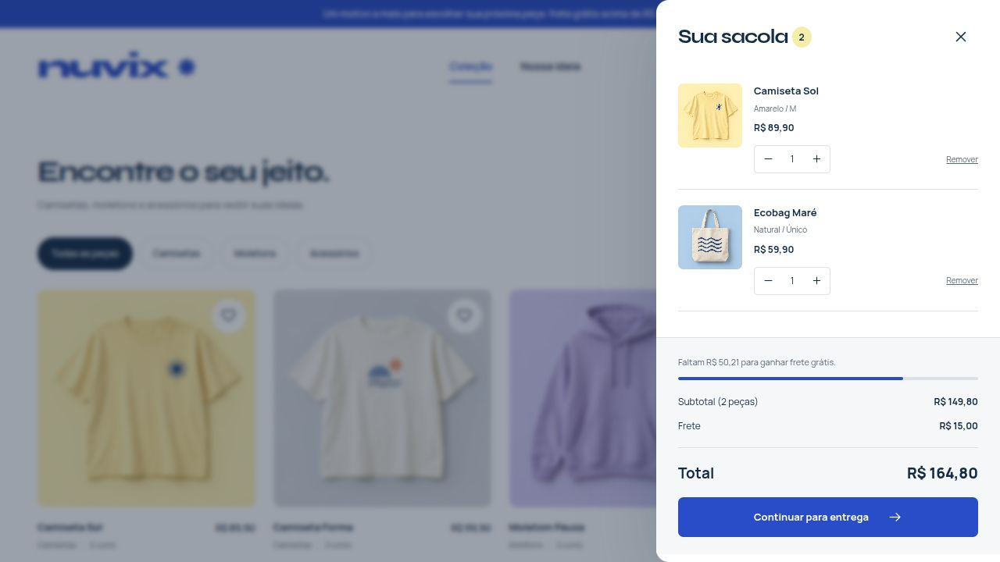](docs/images/aplicacao/04-sacola.jpg)

### Entrega e revisão

Etapas de peças, entrega e revisão; campos de contato e endereço; cupom e confirmação do pedido.

[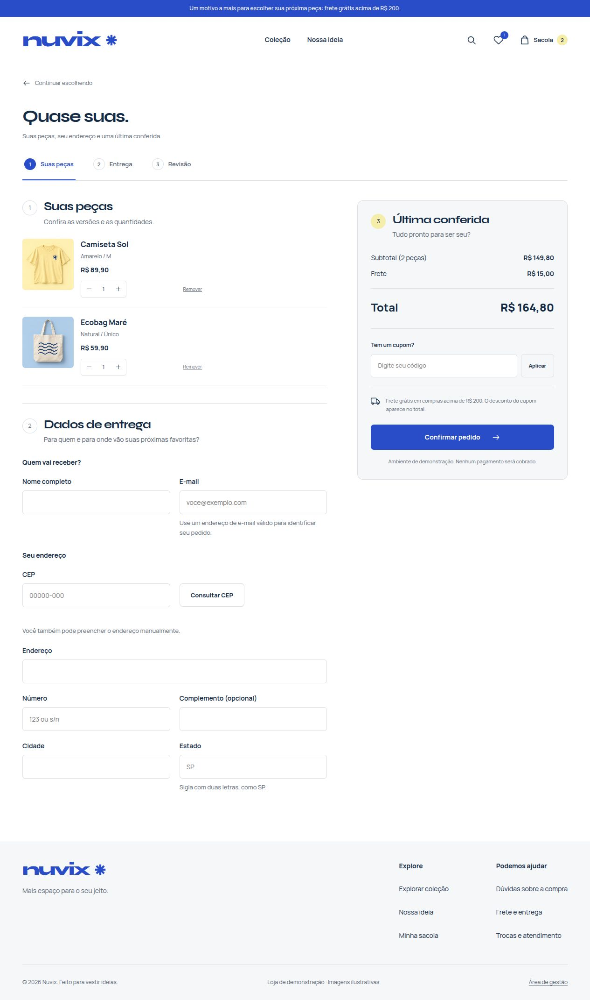](docs/images/aplicacao/05-entrega.jpg)

### Ajuda para comprar

Medidas, frete, cupons, favoritos e informações sobre o funcionamento da demonstração. O rodapé leva diretamente a cada assunto.

[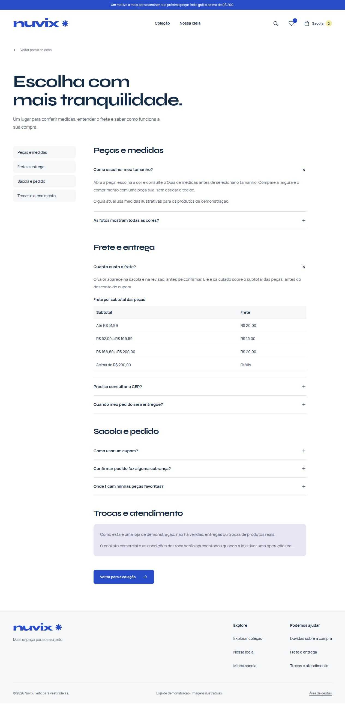](docs/images/aplicacao/11-ajuda.jpg)

### Correção dos dados de entrega

Mensagens junto aos campos e resumo com links para os dados a corrigir. Os demais valores preenchidos são preservados.

[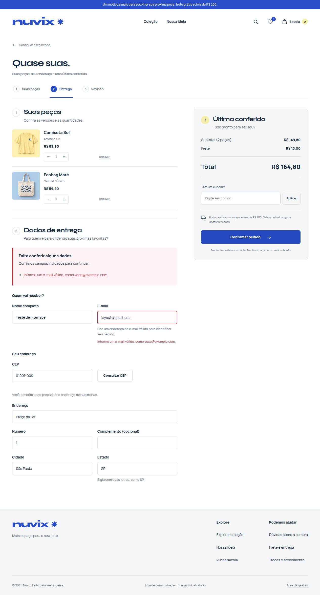](docs/images/aplicacao/12-validacao-entrega.jpg)

</details>

<details>
<summary>Ver a loja no celular</summary>

O cabeçalho mantém busca, favoritos e sacola acessíveis. Na entrega, uma barra fixa mostra o total e o acesso à revisão.

[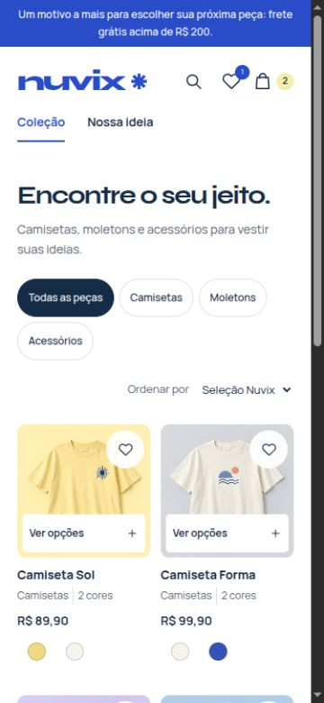](docs/images/aplicacao/09-loja-mobile.jpg)

[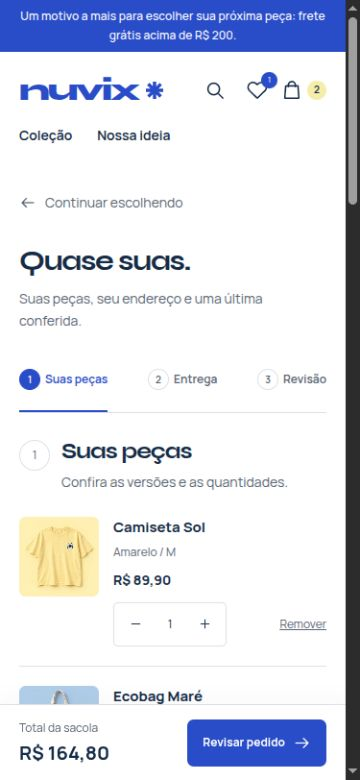](docs/images/aplicacao/10-entrega-mobile.jpg)

</details>

<details>
<summary>Ver a área de gestão</summary>

A gestão usa a identidade Nuvix, com navegação entre Produtos, Pedidos e Cupons, resumos baseados nos registros e listagens com busca e filtros.

### Produtos e variações

[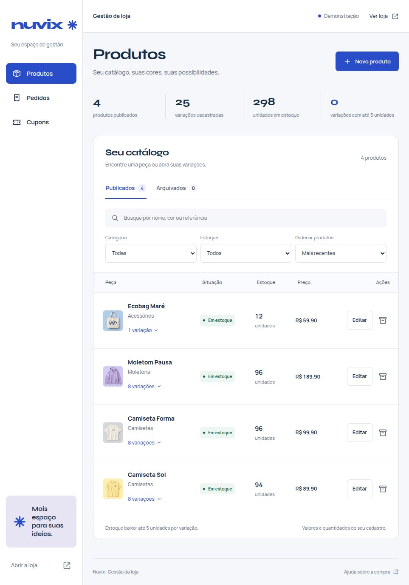](docs/images/aplicacao/06-gestao-produtos.jpg)

[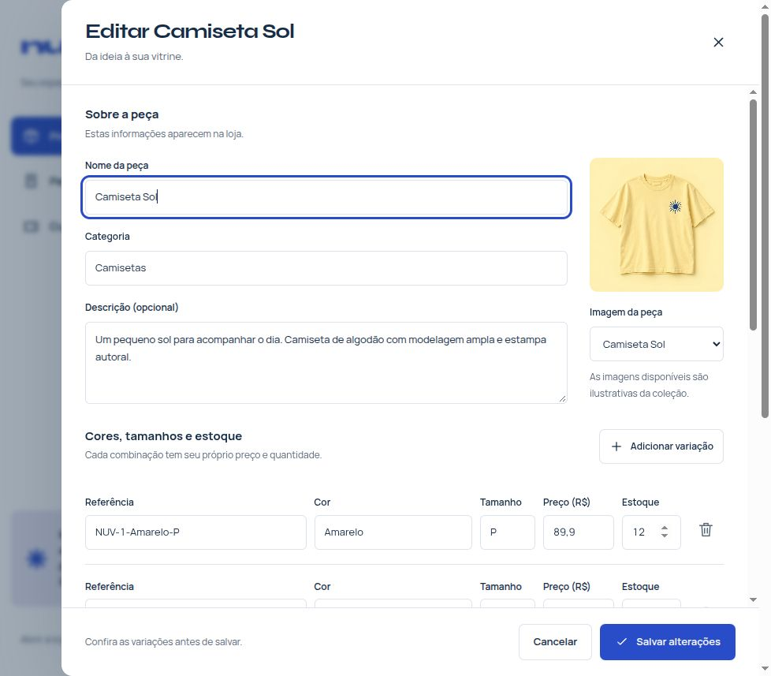](docs/images/aplicacao/13-edicao-produto.jpg)

### Cupons

[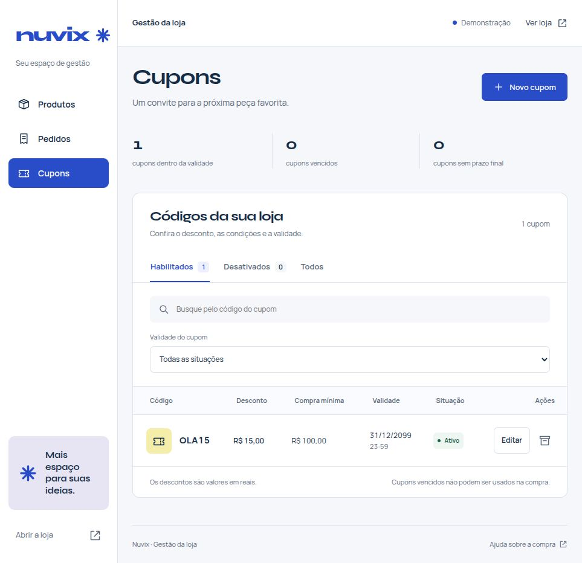](docs/images/aplicacao/07-gestao-cupons.jpg)

### Pedidos

[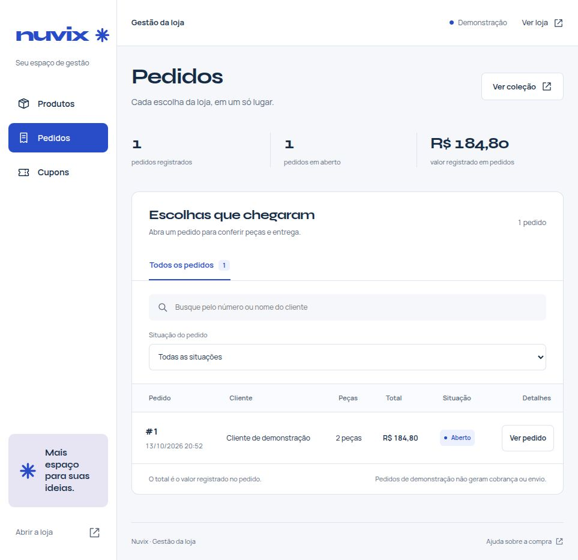](docs/images/aplicacao/08-gestao-pedidos.jpg)

[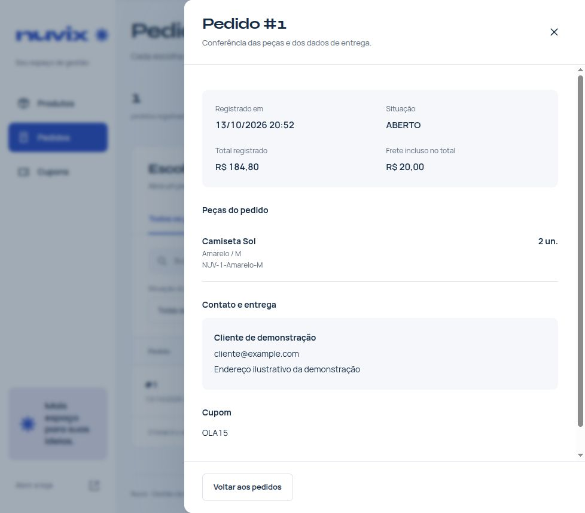](docs/images/aplicacao/15-detalhes-pedido.jpg)

### Gestão no celular

Navegação compacta, filtros identificados e linhas organizadas para leitura em telas menores.

[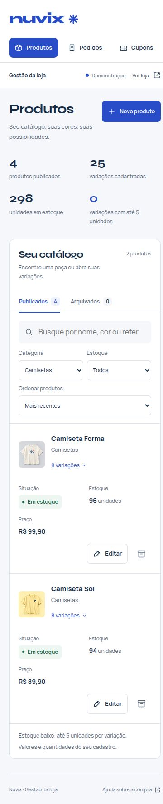](docs/images/aplicacao/14-gestao-mobile.jpg)

</details>

## Funcionalidades

### Loja

- Vitrine e catálogo responsivos, com busca, categorias e ordenação.
- Favoritos salvos no navegador e acessíveis também no celular.
- Cores visíveis nos cartões, com abertura da peça na cor escolhida.
- Página de produto com galeria ampliável, fotos por cor, outros ângulos, tamanhos e guia de medidas.
- Sacola lateral com ajuste de quantidade e remoção de itens.
- Entrega organizada em três partes: peças, endereço e revisão.
- Consulta de CEP, preenchimento manual do endereço, cupom e resumo dos valores.
- Validação junto aos campos, resumo acessível dos erros e conferência dos dados no servidor.
- Área de ajuda com medidas, faixas de frete e informações sobre a demonstração.
- Total fixo no celular durante a navegação pela entrega.
- Preço e estoque conferidos no servidor, com redução do estoque ao registrar o pedido.
- Registro dos dados de entrega e página de confirmação.
- Confirmação por e-mail opcional, configurada por variáveis de ambiente.

### Gestão

- Navegação compartilhada entre Produtos, Pedidos e Cupons, também no celular.
- Busca por nome, cor ou referência; filtros por categoria e estoque; ordenação.
- Lista compacta de produtos, com expansão das variações e acesso à loja.
- Cadastro e edição de nome, categoria, descrição, imagem ilustrativa e variações.
- Controle de preço e estoque por cor e tamanho, com indicação de estoque baixo.
- Inclusão e retirada de variações em uma gravação transacional.
- Arquivamento e recuperação de produtos, preservando o histórico dos pedidos.
- Cadastro e edição de cupons, com validação do código, valores e validade.
- Desativação e reativação de cupons pela própria interface.
- Busca e filtro de pedidos, com consulta de peças, total, contato e endereço.
- Resumos calculados a partir dos registros, sem indicadores de pagamento presumidos.

## Tecnologias

| Camada | Tecnologia |
| --- | --- |
| Aplicação | PHP 8.3+, Slim 4 e Slim PSR-7 |
| Templates | Twig 3 |
| Loja | HTML, CSS e JavaScript sem framework de interface |
| Gestão | HTML, CSS e JavaScript sem framework de interface |
| Banco | SQLite na demonstração; MySQL no ambiente configurado |
| Configuração | PHP dotenv |
| E-mail | PHPMailer com SMTP opcional |
| Tipografia | Syne e Manrope, servidas localmente |

## Executar a demonstração local

### Requisitos

- PHP 8.3 ou superior e Composer.
- PDO com `pdo_sqlite` para a demonstração, ou `pdo_mysql` para MySQL.
- Extensão cURL para consultar CEPs.
- Navegador com JavaScript habilitado.

### Instalação

No Linux, macOS ou Git Bash:

```bash
git clone https://github.com/estevaotl/mini-ecommerce.git
cd mini-ecommerce
composer install
php scripts/setup-local.php
./scripts/serve-local.sh
```

Abra [http://127.0.0.1:8081](http://127.0.0.1:8081).

O script de configuração cria `api/database/loja.sqlite` e o arquivo `api/config/.env` para a demonstração. Ele não substitui uma configuração MySQL existente. Em uma instalação nova, execute esse script antes de copiar o `.env.example`.

A configuração inicial inclui quatro produtos ilustrativos e o cupom **OLA15**, que concede **R$ 15 de desconto em compras a partir de R$ 100**. Executar novamente o script não duplica os produtos já cadastrados.

Os pedidos de demonstração são persistidos no banco local e reduzem o estoque. Nenhum pagamento, envio de e-mail ou entrega é realizado nesse modo. Ainda não há gateway de pagamento integrado.

### Opções do servidor local

| Variável | Uso | Padrão |
| --- | --- | --- |
| `NUVIX_PHP_BIN` | Caminho de outro executável PHP | PHP disponível no ambiente |
| `NUVIX_PORT` | Porta do servidor | `8081` |
| `NUVIX_SESSION_DIR` | Pasta das sessões | `api/database/sessions/` |

Exemplo para usar outra porta:

```bash
NUVIX_PORT=8082 ./scripts/serve-local.sh
```

No Windows sem Git Bash, após instalar as dependências e executar `php scripts/setup-local.php`, use:

```bash
php -S 127.0.0.1:8081 -t app/public
```

Nesse caso, a pasta de sessões configurada no PHP precisa existir e permitir gravação.

## Configurar MySQL

Copie [api/config/.env.example](api/config/.env.example) para `api/config/.env` e ajuste a conexão:

```dotenv
DB_DRIVER=mysql
DB_HOST=localhost
DB_NAME=montink
DB_USER=seu_usuario
DB_PASS=sua_senha
APP_DEMO=false
MAIL_ENABLED=false
```

Para um banco novo, importe primeiro [database.sql](api/database/sql/database.sql), que cria o banco `montink` e as tabelas originais. Em seguida, execute uma vez [loja.sql](api/database/sql/loja.sql), que adiciona os metadados da vitrine e a tabela dos dados de entrega.

```bash
mysql -u seu_usuario -p < api/database/sql/database.sql
mysql -u seu_usuario -p montink < api/database/sql/loja.sql
```

Se o banco original já existe, execute somente a migração `loja.sql`, uma vez. O script de demonstração não importa os produtos ilustrativos para MySQL.

Em Apache, XAMPP ou Laragon, configure o site para apontar para **app/public**, com reescrita de URLs habilitada. Essa é a pasta pública da aplicação.

### Metadados da vitrine

Além do nome e das variações, a tabela `produtos` possui:

| Campo | Uso |
| --- | --- |
| `categoria` | Agrupamento e filtro do catálogo |
| `descricao` | Apresentação e informações da peça |
| `imagem` | Caminho local da foto em `/assets/images/` |
| `imagem_posicao` | Quadrante de 0 a 3 do atlas fotográfico da demonstração |

Fotos individuais usam a imagem inteira. O campo `imagem_posicao` é aplicado somente ao atlas `catalogo.webp`. Nome, categoria e descrição podem ser editados no cadastro de Produtos. O seletor de imagem oferece as quatro referências ilustrativas da coleção; uma imagem individual previamente cadastrada no banco é preservada ao editar a peça. O painel ainda não oferece envio de novas fotos.

Arquivar uma peça a retira da loja e mantém suas variações e os pedidos anteriores. A aba Arquivados permite recuperá-la. Retirar uma variação no editor a desativa ao salvar, sem apagar registros históricos.

## Frete e cupons

O frete segue as regras atuais do projeto, calculadas sobre o subtotal das peças antes do desconto:

| Subtotal | Frete |
| --- | --- |
| Até R$ 51,99 | R$ 20,00 |
| De R$ 52,00 a R$ 166,59 | R$ 15,00 |
| De R$ 166,60 a R$ 200,00 | R$ 20,00 |
| Acima de R$ 200,00 | Grátis |

Uma sacola vazia não cobra frete. Os cupons precisam estar ativos, dentro da validade e respeitar o valor mínimo da compra. Ao alterar a sacola, o total e a elegibilidade do cupom são recalculados.

## Confirmações por e-mail

O envio fica desativado na demonstração. Para habilitá-lo em outro ambiente, configure `APP_DEMO=false`, `MAIL_ENABLED=true` e as variáveis `SMTP_HOST`, `SMTP_PORT`, `SMTP_USER`, `SMTP_PASS` e `SMTP_FROM` no `.env`.

A porta padrão é `587`, com STARTTLS. A porta `465` usa SMTPS. Uma falha na notificação não desfaz um pedido já registrado. Credenciais e bancos locais ficam fora do controle de versão.

## Páginas da aplicação

| Caminho | Página |
| --- | --- |
| `/` | Vitrine Nuvix |
| `/colecao` | Catálogo, busca e favoritos |
| `/peca/{id}` | Detalhes da peça |
| `/ajuda` | Medidas, frete e dúvidas sobre a compra |
| `/carrinho` | Peças, entrega e revisão |
| `/carrinho/retorno` | Confirmação do pedido da sessão |
| `/produtos` | Gestão de produtos e variações |
| `/cupons` | Gestão de cupons |
| `/pedidos` | Consulta dos pedidos |

A rota legada `POST /pedido/webhook-atualizar-pedido-status` permanece no projeto e está fora da cobertura dos testes da loja.

## Testes

```bash
php tests/loja.php
php tests/gestao.php
```

A suíte usa um banco SQLite temporário e isolado. Cobre preço enviado pelo cliente, variações desativadas, quantidades, estoque, faixas de frete, validade e valor mínimo dos cupons, validação por campo, fotos por cor, persistência do pedido e rollback do estoque em caso de falha.

A suíte de gestão cobre validação de cadastros, metadados da loja, inclusão e retirada de variações, identificação de variações de outro produto, arquivamento e recuperação, preservação dos pedidos, validade dos cupons, códigos duplicados e os resumos das listagens. As duas suítes não alteram o banco da demonstração.

Para conferir a interface, navegue pelo catálogo, abra uma peça pela cor do cartão, escolha o tamanho, ajuste a sacola e percorra as etapas de entrega e revisão. No celular, confira os favoritos do cabeçalho e o total fixo da entrega.

Na página da peça, troque a cor e navegue pelas miniaturas. Na entrega, tente confirmar sem preencher os campos e use os links do resumo de erros para corrigi-los. A área de ajuda pode ser acessada pelos links do rodapé.

Na gestão, busque uma cor, filtre uma categoria, abra as variações e confira o editor de uma peça. Para testar ações de gravação, use uma cópia do banco e uma sessão separada. Nos pedidos, o painel apresenta os valores e a situação registrados; ele não confirma pagamento nem executa envios.

## Estrutura do projeto

```text
mini-ecommerce/
├── api/
│   ├── Controllers/       # Rotas e ações da aplicação
│   ├── Core/              # Conexão com o banco
│   ├── Models/            # Persistência
│   ├── Services/          # Catálogo, sacola e notificação
│   ├── config/            # Exemplo e configuração local
│   └── database/sql/      # Esquema original e migração da loja
├── app/
│   ├── Views/             # Templates Twig da loja e da gestão
│   └── public/            # Entrada HTTP, estilos, scripts e imagens
├── docs/
│   └── images/aplicacao/  # Capturas utilizadas neste README
├── scripts/               # Configuração e servidor local
├── tests/                 # Verificações da compra
├── composer.json
└── composer.lock
```

## Design e imagens

A direção visual está em [docs/loja-design.md](docs/loja-design.md). As imagens de campanha e de produtos foram criadas com a ferramenta integrada ImageGen para esta demonstração; os prompts estão em [docs/imagens-prompts.md](docs/imagens-prompts.md). Elas não representam mercadorias reais.

A composição da gestão está em [docs/gestao-design.md](docs/gestao-design.md).

As fotos complementares ficam em [catalogo-galeria.webp](app/public/assets/images/catalogo-galeria.webp). O mapeamento de cores e ângulos em `Api\Services\Catalogo` se aplica aos quatro produtos ilustrativos. Para uma operação comercial, essas referências devem ser substituídas por fotos e medidas reais; contato, prazos e condições de troca também precisam ser definidos.

As fontes [Syne](app/public/assets/fonts/syne-OFL.txt) e [Manrope](app/public/assets/fonts/manrope-OFL.txt) são distribuídas sob SIL Open Font License. Os prints em `docs/images/aplicacao/` mostram a interface real da aplicação local.

## Autor e licença

Desenvolvido por **Estêvão Leite** — [LinkedIn](https://linkedin.com/in/estevao-leite) e [e-mail](mailto:estevaotlnf@gmail.com).

Projeto distribuído sob a [licença MIT](LICENSE).
